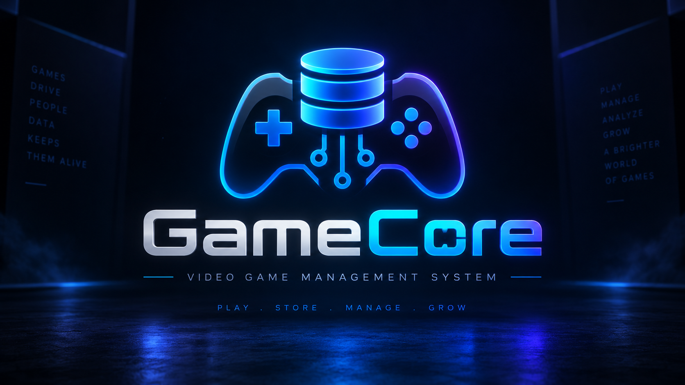

<div align="center">



<p align="center">

</p>


<br/>


**Video Game Management System**

Sistema full stack para administrar el ecosistema operativo de una empresa de videojuegos: **catálogo, clientes, ventas, empleados, distribución y analítica**, construido como restauración moderna de un proyecto académico de bases de datos.

<p>
  
  
  
  
</p>

<a href="https://github.com/Jairo0811/GameCore/actions/workflows/ci.yml">
  
</a>

<br/><br/>

**PLAY · STORE · MANAGE · GROW**

</div>

---

## 🎮 ¿Qué es GameCore?

**GameCore** es una aplicación de gestión orientada a una empresa que desarrolla, administra o distribuye videojuegos.

Su objetivo es centralizar información del negocio y convertirla en operaciones reales dentro de una misma plataforma:

- 🎮 administración del catálogo de videojuegos;
- 🧩 géneros, plataformas y clasificaciones;
- 👥 gestión de clientes;
- 🧾 registro de ventas y detalle de productos;
- 👨‍💼 administración de empleados, cargos y sucursales;
- 🌎 distribución de videojuegos por país;
- 📊 dashboard con indicadores y rendimiento comercial;
- 🗄️ consultas y reporting respaldados directamente por SQL Server.

GameCore **no pretende ser un POS de tienda tradicional**. Aunque registra ventas, su foco está en administrar el ecosistema de la empresa y sus datos, no en funciones de caja como turnos de cajero, arqueos o inventario físico detallado.

---

## ✨ Funcionalidades principales

| Módulo | Función |
|---|---|
| 📊 **Dashboard** | KPIs de videojuegos, clientes, ventas, empleados, ingresos y títulos más vendidos |
| 🎮 **Videojuegos** | Alta, edición, desactivación y consulta del catálogo |
| 🧩 **Catálogos** | Géneros, plataformas y clasificaciones por edad |
| 👥 **Clientes** | Registro y actualización de clientes |
| 🧾 **Ventas** | Ventas transaccionales con múltiples videojuegos por operación |
| 👨‍💼 **Empleados** | Personal, sucursales, cargos y estado |
| 🌎 **Distribución** | Distribución de títulos por países y cantidades |
| 📈 **Reportes** | Ventas mensuales, rendimiento por juego, valor por cliente y distribución geográfica |
| 🔐 **Seguridad** | JWT + roles (Admin, Manager, Viewer) aplicados por políticas en cada endpoint |
| 🧪 **SQL avanzado** | Views, stored procedures, funciones, transacciones y reporting |

---

## 🏗️ Arquitectura

```text
┌─────────────────────────────┐
│ React + TypeScript + Vite   │
│        Frontend Web         │
└──────────────┬──────────────┘
               │ HTTP / JSON
               ▼
┌─────────────────────────────┐
│ ASP.NET Core Web API        │
│ JWT · RBAC · ProblemDetails │
└──────────────┬──────────────┘
               │
               ▼
┌─────────────────────────────┐
│ Domain                      │
│ Application                 │
│ Infrastructure              │
└──────────────┬──────────────┘
               │ Entity Framework Core
               ▼
┌─────────────────────────────┐
│ GameCoreDB · SQL Server     │
│ Tables · Views · SP · UDF   │
└─────────────────────────────┘
```

La restauración mantiene un enfoque **database-first**: los scripts de `database/` siguen siendo la fuente principal del esquema y Entity Framework Core mapea la base existente.

---

## 🧱 Stack tecnológico

### Frontend

- **React 19**
- **TypeScript**
- **Vite**
- interfaz responsive
- cliente HTTP autenticado mediante Bearer Token
- identidad visual GameCore integrada

### Backend

- **.NET 10**
- **ASP.NET Core Web API**
- **C#**
- **Entity Framework Core**
- **JWT Bearer Authentication** + autorización por roles (policies)
- **ProblemDetails** (RFC 7807) y manejo global de errores
- health check con verificación real de SQL Server
- separación por capas:
  - `GameCore.Domain`
  - `GameCore.Application`
  - `GameCore.Infrastructure`
  - `GameCore.WebAPI`

### Base de datos

- **Microsoft SQL Server**
- claves primarias y foráneas
- restricciones `CHECK` y `UNIQUE`
- índices
- views
- stored procedures
- funciones escalares
- transacciones
- `OPENJSON`
- reporting SQL

### DevOps / calidad

- **xUnit** (API sobre SQLite + integración opcional con SQL Server real)
- **Vitest** (sesión, cliente HTTP y manejo de 401/403)
- **Docker** / **Docker Compose** (stack local completo con inicialización de la BD)
- **GitHub Actions** (build, tests, auditorías y arranque full-stack en contenedores)
- chequeo de vulnerabilidades NuGet y `npm audit`
- smoke test y release check en PowerShell

---

## 🗄️ Modelo de datos

El modelo moderno amplía el diseño académico original y separa correctamente las responsabilidades principales:

```text
Companies
 └── Branches
      └── Employees
           └── JobPositions

Games
 ├── AgeRatings
 ├── GameGenres ── Genres
 ├── GamePlatforms ── Platforms
 └── Distributions ── Countries

Customers
 └── Sales
      └── SaleDetails
           └── Games

AppUsers
 └── JWT Authentication
```

Una de las mejoras fundamentales respecto al modelo original fue reemplazar:

```text
Cliente → Videojuego
```

por:

```text
Cliente → Venta → Detalle de Venta → Videojuego
```

Esto permite que un cliente tenga múltiples compras y que una venta contenga múltiples videojuegos.

---

## 🔌 API

La API expone recursos bajo `/api`. Todo excepto el login requiere un token JWT.

### Autenticación

```text
POST /api/auth/login        → { token, email, role, expiresAt }   (token válido 8 h)
```

### Roles

| Rol | Lectura (GET) | Crear / editar / desactivar |
|---|:---:|:---:|
| **Viewer** | ✅ | ❌ (HTTP 403) |
| **Manager** | ✅ | ✅ |
| **Admin** | ✅ | ✅ |

No existen endpoints exclusivos de Admin: la administración de usuarios queda fuera del alcance de v1.

### Recursos

```text
GET    /api/games                     Viewer+
POST   /api/games                     Manager+   (juego + géneros + plataformas, atómico)
PUT    /api/games/{id}                Manager+
DELETE /api/games/{id}                Manager+   (desactivación lógica)

GET    /api/customers                 Viewer+
POST   /api/customers                 Manager+
PUT    /api/customers/{id}            Manager+

GET    /api/sales                     Viewer+
POST   /api/sales                     Manager+   (transaccional, precio histórico)

GET    /api/employees                 Viewer+
POST   /api/employees                 Manager+
PUT    /api/employees/{id}            Manager+

GET    /api/distributions             Viewer+
POST   /api/distributions             Manager+   (alta; si Juego+País+Fecha ya existe actualiza unidades)
PUT    /api/distributions/{id}        Manager+   (edita ese registro, incluso juego/país/fecha)

GET    /api/catalogs                  Viewer+
GET    /api/dashboard                 Viewer+
GET    /api/reports                   Viewer+

GET    /health                        anónimo    (503 si GameCoreDB no responde)
```

### Errores y validación

Los errores usan **ProblemDetails** (`application/problem+json`) sin trazas internas:

- **400**: datos inválidos (obligatorios, longitudes, precios, cantidades, fechas, correos, IDs inexistentes, IDs repetidos);
- **401**: sin token o token expirado/inválido; **403**: rol sin permiso;
- **404**: recurso inexistente; **409**: duplicados (correo de cliente/empleado, título+fecha de juego, juego+país+fecha de distribución).

Las validaciones se hacen **antes** de escribir en SQL Server; por ejemplo, una venta con el mismo `GameId` repetido devuelve 400 en lugar de chocar con `UQ_SaleDetails_Sale_Game`.

---

## 🗂️ Estructura del repositorio

```text
GameCore/
├── database/
│   ├── advanced/
│   │   ├── functions.sql
│   │   ├── procedures.sql
│   │   ├── reports.sql
│   │   ├── validate.sql
│   │   └── views.sql
│   ├── schema.sql
│   ├── seed.sql
│   ├── security.sql
│   ├── setup.sql
│   ├── reset.sql
│   └── validate.sql
│
├── src/
│   ├── backend/
│   │   ├── GameCore.Domain/
│   │   ├── GameCore.Application/
│   │   ├── GameCore.Infrastructure/
│   │   ├── GameCore.WebAPI/
│   │   ├── GameCore.Tests/
│   │   └── GameCore.sln
│   │
│   └── frontend/
│       ├── public/brand/
│       └── src/
│
├── docs/
│   ├── original/
│   ├── database/
│   └── RELEASE.md
│
├── scripts/
│   ├── docker/init-db.sh
│   ├── release-check.ps1
│   ├── setup-db.ps1
│   └── smoke-test.ps1
│
├── .env.example
├── Dockerfile.backend
├── Dockerfile.frontend
├── docker-compose.yml
└── README.md
```

---

## 🎨 Identidad visual

La identidad de GameCore combina los dos conceptos centrales del proyecto:

- 🎮 **mando de videojuegos** → industria y catálogo;
- 🗄️ **base de datos** → origen académico y núcleo de información.

Los assets utilizados por la aplicación están incluidos en:

```text
src/frontend/public/brand/
├── gamecore-logo.png          logo principal (sidebar)
├── gamecore-icon.svg          isotipo y favicon
├── gamecore-login-cover.png   portada del login
└── gamecore-cover.png         portada de este README
```

---

## 🎓 Origen académico

GameCore nació como proyecto final de **Introducción a las Bases de Datos (SOF-006)** en el **Instituto Tecnológico de Las Américas (ITLA)**.

| Información | Detalle |
|---|---|
| 🏫 Institución | **Instituto Tecnológico de Las Américas (ITLA)** |
| 📖 Asignatura | **Introducción a las Bases de Datos (SOF-006)** |
| 👨‍🏫 Profesor | **Freidy Ramón Núñez Pérez** |
| 📅 Período académico | **2016-C2** |
| 👨🏻‍💻 Estudiante | **Francis Jairo Matías Rosario — 2015-2984** |
| 📁 Entrega original | **Proyecto Final** |
| 🛠️ Restauración | **2026** |

La versión original se concentraba en:

- creación de tablas;
- claves primarias y foráneas;
- `INSERT`;
- filtros;
- `JOIN`;
- consultas básicas en SQL Server.

El archivo histórico se conserva en:

```text
docs/original/TAREA-FINAL.sql
```

Ese código **no fue reescrito para ocultar sus limitaciones**. Se conserva como evidencia del proyecto inicial y la versión moderna vive de forma separada para mostrar claramente la evolución técnica.

---

## 🧭 Continuidad académica

### 👨‍🏫 Continuidad por profesor

**GameCore** y [**PySL**](https://github.com/Jairo0811/PySL) documentan dos proyectos académicos distintos cursados con el profesor **Freidy Ramón Núñez Pérez** durante el mismo período **2016-C2**.

| Orden | Asignatura | Proyecto | Período |
|---:|---|---|---|
| 1 | Fundamentos de Programación (SOF-001) | [**PySL**](https://github.com/Jairo0811/PySL) | 2016-C2 |
| 2 | Introducción a las Bases de Datos (SOF-006) | **GameCore** | 2016-C2 |

La relación es **académica, docente y formativa**. Ambos proyectos corresponden a asignaturas diferentes cursadas en paralelo durante el mismo cuatrimestre y no existe dependencia técnica entre ellos.

---

## 🔄 Evolución del proyecto

```text
Proyecto académico SOF-006
          ↓
Modelo relacional + SQL Server
          ↓
Rediseño de base de datos
          ↓
SQL Server Core
          ↓
Advanced SQL
          ↓
.NET 10 + EF Core
          ↓
REST API + JWT
          ↓
React + TypeScript
          ↓
GameCore
```

### Fases de restauración

| # | Fase | Estado |
|---:|---|:---:|
| 0 | Legacy Preservation | ✅ |
| 1 | Database Redesign | ✅ |
| 2 | SQL Server Core | ✅ |
| 3 | Advanced SQL | ✅ |
| 4 | .NET Foundation | ✅ |
| 5 | REST API | ✅ |
| 6 | React Foundation | ✅ |
| 7 | Game Management | ✅ |
| 8 | Customers & Sales | ✅ |
| 9 | Employees & Distribution | ✅ |
| 10 | Dashboard & Reports | ✅ |
| 11 | Security & Validation | ✅ |
| 12 | Portfolio Hardening | ✅ |
| 13 | Release 1.0 | ⏳ verificación final |

---

## 🚀 Ejecución local

### 1. Base de datos

Desde la raíz del repositorio (bootstrap oficial UTF-8):

```powershell
.\scripts\setup-db.ps1                 # SQL Server local (Windows auth)
.\scripts\setup-db.ps1 -SqlExpress     # SQL Server Express
```

- Si `GameCoreDB` **no existe**, ejecuta `database/setup.sql`: esquema, seed, usuarios demo, views, funciones, procedures y validaciones.
- Si **ya existe**, no la modifica: solo la valida.
- `-Reset` la elimina y la recrea (**destructivo**, pide confirmación).

> Si tienes una `GameCoreDB` creada con una versión anterior del repositorio, actualízala sin perder datos con `.\scripts\setup-db.ps1 -Upgrade` (`database/upgrade-v1.sql`: índices únicos filtrados de email, usuarios Manager/Viewer y nombres ficticios en los empleados demo). La alternativa es recrearla con `-Reset`.

### 2. Backend

```powershell
dotnet restore src/backend/GameCore.sln
dotnet build src/backend/GameCore.sln -c Release
dotnet run --project src/backend/GameCore.WebAPI/GameCore.WebAPI.csproj
```

API local predeterminada: `http://localhost:5152`

Configuración relevante (appsettings o variables de entorno):

| Clave | Uso |
|---|---|
| `ConnectionStrings:GameCoreDb` | conexión a SQL Server |
| `Jwt:Key` | clave HMAC (≥ 32 bytes). En `Production` no puede empezar por `CHANGE-ME` |
| `Cors:AllowedOrigins` | orígenes del frontend (por defecto `http://localhost:5173`; `*` no está permitido) |

### 3. Frontend

```powershell
cd src/frontend
npm ci
npm run dev
```

Frontend local: `http://localhost:5173`

---

## 🔑 Cuentas de demostración

Contraseña de las tres cuentas: `GameCore123!`

| Correo | Rol |
|---|---|
| `admin@gamecore.local` | Admin |
| `manager@gamecore.local` | Manager |
| `viewer@gamecore.local` | Viewer (solo lectura) |

> En `npm run dev` el login aparece precargado con la cuenta Admin. En un build de producción (`npm run build`, Docker) los campos aparecen vacíos.
> Las cuentas demo y la clave JWT del repositorio son exclusivamente para desarrollo local. Deben cambiarse antes de cualquier despliegue real.

---

## 🐳 Docker (solo desarrollo local)

```powershell
docker compose up --build
```

El stack levanta, en orden:

1. **sqlserver**: SQL Server 2022 con healthcheck real (`SELECT 1`);
2. **db-init**: ejecuta `database/setup.sql` si `GameCoreDB` no existe (esquema, seed, AppUsers, SQL avanzado y validaciones). Si ya existe, solo la valida y **nunca la borra**;
3. **api** (`http://localhost:8080`): arranca cuando `db-init` termina bien, con healthcheck sobre `/health`;
4. **frontend** (`http://localhost:5173`): build de producción servido por nginx.

Los valores por defecto (contraseña `sa`, clave JWT, puertos) se pueden cambiar con un `.env` basado en `.env.example`. El stack usa `ASPNETCORE_ENVIRONMENT=Development`. Si pasas a `Production`, debes definir una `GAMECORE_JWT_KEY` real.

Para empezar de cero: `docker compose down -v`.

> La pipeline `full-stack` de GitHub Actions construye y arranca este stack desde cero en cada push y ejecuta contra él el smoke test y los tests de integración con SQL Server.

---

## 🧪 Validación

Un solo comando valida BD, backend, tests, auditorías, frontend, API y smoke test:

```powershell
.\scripts\release-check.ps1
```

Opciones útiles: `-SqlExpress`, `-Server`/`-SqlUser`/`-SqlPassword` (p. ej., para el SQL Server de Docker), `-ResetDatabase` (destructivo, pide confirmación) e `-IncludeSqlServerTests` (escribe datos demo). Si la API no está corriendo, el script la arranca y la detiene al terminar.

Comandos individuales:

```powershell
dotnet test src/backend/GameCore.sln -c Release
dotnet list src/backend/GameCore.sln package --vulnerable --include-transitive

cd src/frontend
npm test
npm audit --audit-level=high
```

Tests de integración contra SQL Server real (crean registros, úsalos solo con una BD desechable):

```powershell
$env:GAMECORE_TEST_SQLSERVER = "Server=localhost;Database=GameCoreDB;Trusted_Connection=True;TrustServerCertificate=True"
dotnet test src/backend/GameCore.sln -c Release --filter "FullyQualifiedName~GameCore.Tests.SqlServer"
```

El proceso completo de release está en `docs/RELEASE.md`.

---

## 🔒 Privacidad y preservación

Los datos personales presentes en el artefacto académico original se conservan únicamente como parte del contexto histórico del proyecto.

La aplicación moderna utiliza **datos de demostración ficticios**: los nombres, teléfonos y correos del seed (`database/seed.sql`) son inventados y no reutilizan identificadores personales del artefacto original, que permanece sin cambios en `docs/original/`.

---

## 📌 Estado

**v1.0.0: candidata a congelación.**

La etiqueta definitiva `v1.0.0` se crea solo cuando el checklist de `docs/RELEASE.md` está completo, incluyendo el job `full-stack` de CI (Docker desde cero + smoke test + integración con SQL Server) y `scripts/release-check.ps1` en local.

---

<div align="center">

### GameCore

**Del modelo relacional a una aplicación full stack.**

PLAY · STORE · MANAGE · GROW

</div>
